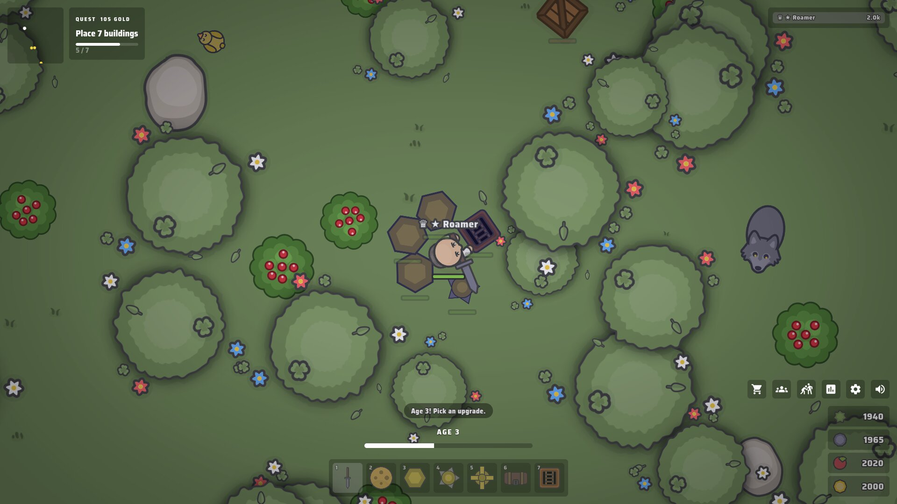
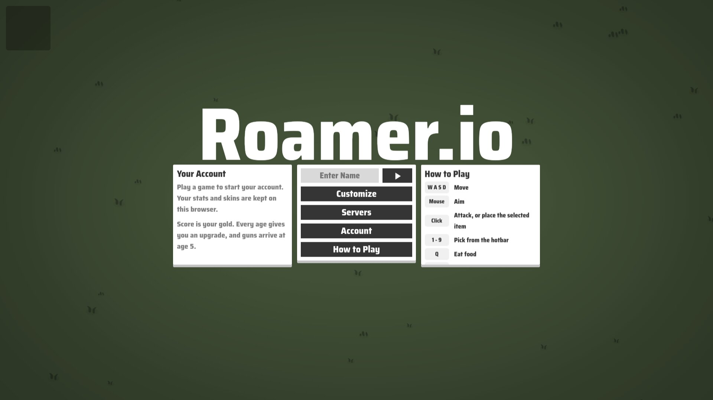
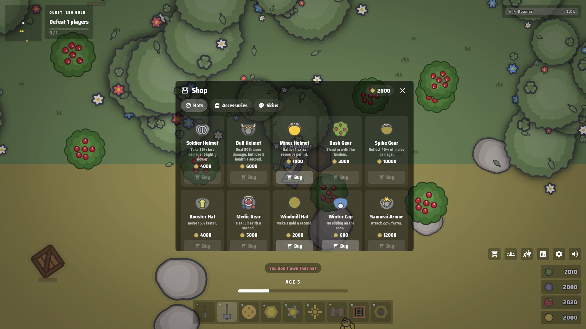
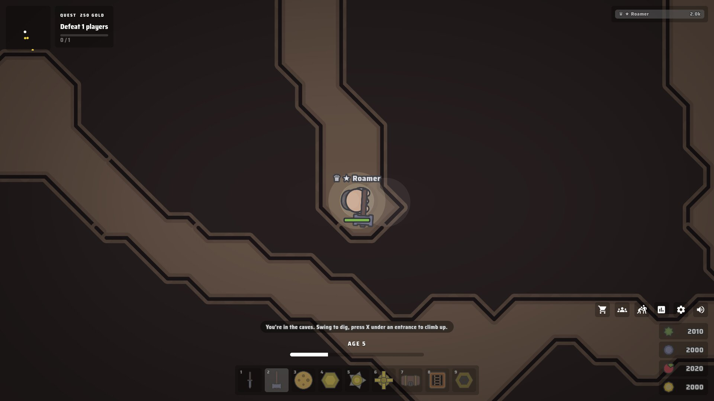

<div align="center">

# Roamer.io

<p align="center">
    <sub>A multiplayer survival game in your browser.</sub>
    <br />
    <sub>Harvest resources. Age up. Build a base. Dig tunnels. Fight other players.</sub>
    <br />
    <sub>Heavily inspired by moomoo.io and foes.io!</sub>
</p>

[](https://www.rust-lang.org/)
[](https://developer.mozilla.org/en-US/docs/Web/JavaScript)
[](https://webassembly.org/)
[](https://developer.mozilla.org/en-US/docs/Web/API/WebTransport_API)
[](LICENSE)




</div>

---
> [!NOTE]
> **Roamer.io is still under active development!** More features are to come.


## Features:

- Ten ages of progression, each giving you an upgrade to pick:
- - Every moomoo.io weapon, plus a Shovel for digging.
- - foes.io guns from age 5: pistols, SMGs, rifles, shotguns, snipers and a laser rifle.
- - Weapon variants: use a weapon enough and it turns Gold, Diamond, Ruby, then Emerald.
- Over 25 buildings:
- - Walls, spikes, windmills, mines, saplings, pit traps, boost pads, turrets and platforms.
- - Healing pads, spawn pads, blockers, teleporters, chests and TNT.
- - Buildings crack as they're damaged and heal over time.
- Caves and tunnels:
- - Dig through solid rock underground, with smooth marching-squares walls.
- - Players on the surface can't see you down there.
- - Place Tunnels to dig your own way in and out.
- A big map with snow (ice!), grassland, desert, lava, ocean and sand biomes.
- Animals and bosses that wander, flee, hunt and pathfind around obstacles.
- Loot crates whose color shows the weapon variant needed to open them.
- Clans with roles and resource trading.
- An arena for 1v1 up to 4v4 fights, with custom loadouts and rules.
- Quests, world events, and a leaderboard with crown, skull and star icons.
- A hat and accessory shop, plus skins that stay on your account.
- Texture pack support: drop in your own images.
- Anti cheat:
- - A proof-of-work challenge before connecting.
- - Perfect aim and hat switching detection.
- - A one day IP blacklist for flagged players.


## Live Demo

---
> [!WARNING]
> The live demonstration is not a main priority, and therefore is not obligated to stay up to date with the repository.
> It is encouraged for you to clone the repository and host it yourself to play with your friends!


## Getting Started

You will need the following installed:
- Rust (nightly)
- wasm-pack
- Bun or Node.js
- mkcert

To install wasm-pack:
```bash
cargo install wasm-pack
```

WebTransport needs a trusted TLS certificate, even locally. Make one with mkcert:
```bash
mkcert -install
mkcert -cert-file server/cert.pem -key-file server/key.pem 127.0.0.1 localhost
```

Then you can run
```bash
chmod +x run_client.sh run_server.sh

# run this in one terminal
./run_server.sh

# run this in another
./run_client.sh
```
and open http://localhost:5173.

`run_server.sh` builds an optimized server by default (use `--debug` for faster builds). Logs go to `server/server.log`.
The ports can be changed with `GAME_PORT`, `POW_PORT` and `CLIENT_ORIGIN` for the server, and `CLIENT_PORT`, `VITE_GAME_PORT` and `VITE_POW_PORT` for the client.

Run the server with `ROAMER_DEV=1` to enable developer chat commands like `/xp`, `/res`, `/tp` and `/event`.


## Hosting

The `release/` folder holds a ready-to-run copy of the game: static binaries for the server and the web client, and one command that sets everything up and starts both (and starts them on boot):
```bash
./build_release.sh   # build it (or rebuild after changes)
./release/roamer.sh  # set up and start, then open http://localhost:8081
```
By default it uses TCP 8081 for the web page and UDP 8082 for the game, listening on `[::]` (IPv6 and IPv4). See [release/README.md](release/README.md) for ports, HTTPS and the other commands.


## Controls

| Key | Action |
| --- | --- |
| W A S D | Move |
| Mouse | Aim |
| Click | Attack, place the building or eat the food in your hand |
| 1 - 9 | Pick from the hotbar |
| Q | Take out food |
| E / F | Quick wall / spikes |
| X | Go down or up a cave entrance or Tunnel |
| B | Shop |
| C | Clan |
| V | Arena |
| Enter | Chat |
| \\ | Lean the camera towards the mouse |
| Esc | Close panels |


## Note on Networking

The client talks to the server over WebTransport. Movement and aim are sent as unreliable datagrams; everything else goes over one ordered, reliable stream in each direction.
Packets are encoded with [borsh](https://borsh.io/).


## Note on Cryptography

This project utilizes a hybrid handshake: [X25519](https://cryptography.io/en/latest/hazmat/primitives/asymmetric/x25519/) together with post-quantum [Kyber768](https://pq-crystals.org/kyber/) (the algorithm ML-KEM is based on).
The shared secret establishes a [ChaCha20Poly1305](https://en.wikipedia.org/wiki/ChaCha20-Poly1305) cipher for every packet.


## Why use Rust?

Rust is incredible. The server runs the whole world every tick, and Rust makes that fast with no garbage collector pauses.
On top of that, a language that prevents a whole suite of bugs at compile time is what everyone dreams of!

The client is JavaScript so it can use PixiJS, but its packet handling is the same Rust code as the server, compiled to WebAssembly.


## Contribution Guidelines

Contributions are welcome! Please keep `cargo clippy` clean (the workspace uses strict lints) and run `cargo fmt` before opening a pull request.
Final decisions on what code is accepted are made by me, at my own discretion.


## AI Usage

Large parts of this project were written with the help of AI (Claude Code), including many of the gameplay systems and much of the client UI.


## Assets

The moomoo.io and foes.io sprites come from [al007ex/2d-game-assets](https://github.com/al007ex/2d-game-assets) and belong to their original creators. They are not covered by this project's license.


# Screenshots
## Homescreen


## In game


## Shop


## Caves

